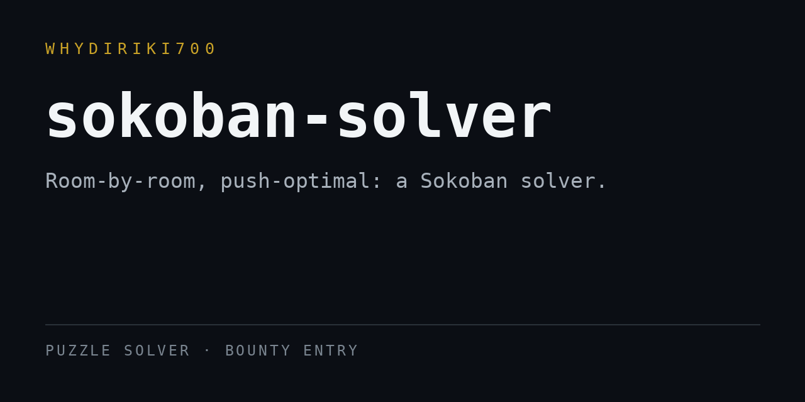

# sokoban-solver

A room-by-room, push-optimal Sokoban solver, built for the make.fun
sokoban-solver-01 bounty.

The solver lives in a single TypeScript entry, `main.ts`. It works through
the puzzle room by room and optimizes for the number of pushes, not just
the number of moves, which is the metric that separates a finished
Sokoban run from an efficient one.

## Layout

- `main.ts`: the solver
- `LICENSE`: MIT license

## Related

- `sokoban-solver-01-run-20261121`: the recorded run of this solver on the
  bounty rooms
